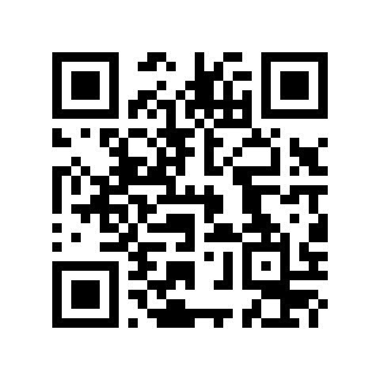
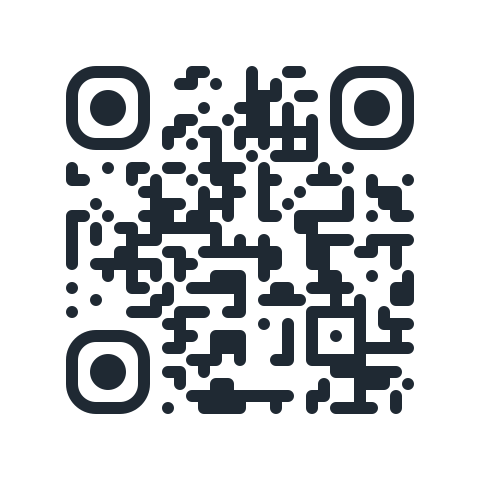
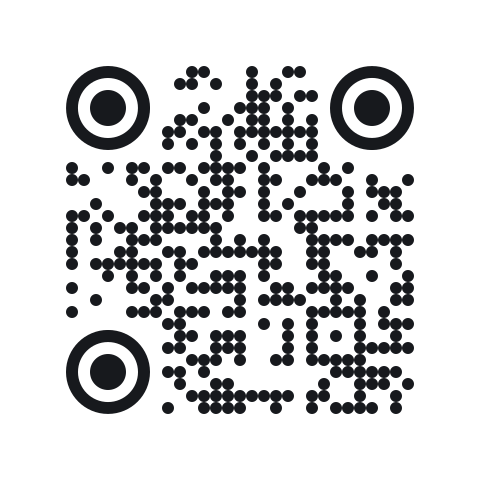
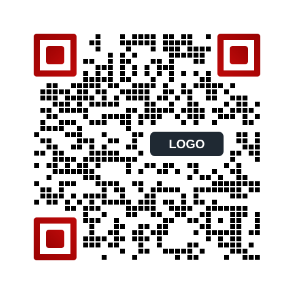

# QR Code Designer for YOURLS

[](https://github.com/Waterproof-Web-Wizard-GmbH/yourls-qr-code-designer/actions/workflows/tests.yml)
[](LICENSE)
[](https://yourls.org/)
[](https://www.php.net/)

**QR Code Designer is a free YOURLS plugin that creates print-ready, styled QR codes for every short URL.** Pick colours and gradients, dot and corner shapes, add your logo and move it anywhere inside the safe area of the code. A print check calculates the right resolution, and a built-in scan test reads every code before you download it. Everything runs in your browser: no short URL, logo or click data is sent to a third-party service.

<p>
  
  
  
  
</p>

*All four codes point to the same short URL. Each one was decoded with zbar and jsQR before it went into this README.*

[Deutsche Kurzfassung](#deutsch)

## Features

**Design**
- **"QR" button in the link list.** One click opens the designer with the short URL filled in.
- **Colours and gradients** for dots and corner markers, solid or transparent background.
- **Shapes:** six dot styles, four corner frames (square, slightly rounded, rounded, circle) and three corner dots.
- **Dot gap:** spaced dots from 0 to 30 %, for the airy look many print designers use.
- **Presets:** Classic, Rounded, Dots and Spaced squares built in. Save your own default in the browser, logo included, or ship company presets with a filter.

**Logo**
- **Your logo in the code.** PNG, JPG, WebP or SVG. The file stays in your browser.
- **Safe positioning:** move the logo with two sliders or drag it in the preview. It stops before finder patterns, timing patterns, format and version information and alignment patterns, with one module of air around them. The only exception is an alignment pattern in the very centre, which every centred logo covers; the scan test checks the result.
- **Free space around the logo** from 0 to 3 modules, dots behind the logo hidden or shown.
- **Size guard:** the logo box never covers more than 15 % of the code. Error correction switches to level H automatically.

**Print and safety**
- **Print check:** enter the printed width, 300 or 600 dpi and the scan distance. The plugin sets the export size, shows the module size and warns when modules get smaller than 0.4 mm, when the code is too small for the distance (distance ÷ 10) or when your logo file has too few pixels for the print size.
- **Built-in scan test:** after every change, the code is decoded in the browser with [jsQR](https://github.com/cozmo/jsQR) at four sizes. If it cannot be read, you see why, and the download asks for confirmation.
- **Contrast warnings** (WCAG contrast ratio) for dots, gradients and corner markers, plus inverted colours and transparent backgrounds.
- **Export:** PNG, SVG (vector, for print shops) and JPG from 200 to 6000 px (larger prints: SVG, the print check tells you), "Copy PNG" to the clipboard. The quiet zone is set in modules (0, 2 or the ISO standard 4), so it stays correct at every size.

**Quality**
- **Accessible:** labelled controls, keyboard friendly sliders, status messages announced to screen readers once, not on every slider step.
- **Translated:** English and German included, ready for more languages.
- **No external requests:** [qr-code-styling](https://github.com/kozakdenys/qr-code-styling) 1.9.2 (MIT) and jsQR 1.4.0 (Apache 2.0) are bundled. CI checks that both files are byte-identical to their npm releases.
- **Tested:** PHPUnit with the official YOURLS test suite for plugins, Node tests that render real codes and decode them, and a headless smoke test of the admin page.

## Requirements

- YOURLS 1.10 or newer (tested with 1.10.6 and the current development version)
- PHP 8.1 or newer (as required by YOURLS 1.10)
- A current browser (Chrome, Edge, Firefox or Safari)

## Installation

1. Download the [latest release](https://github.com/Waterproof-Web-Wizard-GmbH/yourls-qr-code-designer/releases/latest) or clone the repository:
   ```bash
   cd /path/to/yourls/user/plugins
   git clone https://github.com/Waterproof-Web-Wizard-GmbH/yourls-qr-code-designer.git
   ```
   Copy or clone the folder itself. A symlinked plugin folder breaks the asset URLs, as with most YOURLS plugins.
2. In the YOURLS admin, open **Manage Plugins** and activate **QR Code Designer**.
3. Click **QR** next to any short URL, or open **QR Code Designer** in the plugin menu.

To uninstall, deactivate the plugin and delete the folder. The plugin stores nothing in the database. Saved defaults live in your browser's local storage.

## Usage

1. Click **QR** in the link list. The short URL appears as the QR content.
2. Choose a preset or set colours, gradients, shapes and dot gap.
3. Optional: add a logo, set its size and free space, and move it where you like.
4. Under **Print**, enter the printed width. The export size follows.
5. Wait for **Scan test passed**, then download **SVG** for print or **PNG** for web.
6. Before a large print run, test the printed proof with two different phones.

Tip: keep the short URL in the code and change the target in YOURLS later. Printed codes keep working when the landing page changes.

## Company presets

Give everyone on your YOURLS instance your brand style with one click. Put this into a small plugin of your own, for example `user/plugins/my-presets/plugin.php`:

```php
<?php
/*
Plugin Name: My QR presets
*/
yourls_add_filter( 'qrcd_presets', function ( array $presets ): array {
    $presets['brand'] = [
        'label'      => 'Our brand',
        'fg'         => '#000000',         // dots
        'fg2'        => '',                // second dot colour for a gradient, '' = none
        'corner'     => '#9b0202',         // corner markers
        'corner2'    => '#bc0a0a',         // second corner colour for a gradient
        'bg'         => '#ffffff',
        'dots'       => 'square',          // square, rounded, extra-rounded, dots, classy, classy-rounded
        'cornersq'   => 'rounded',         // square, rounded, extra-rounded, dot
        'cornerdot'  => 'rounded',         // square, rounded, dot
        'gap'        => 0.2,               // dot gap 0 to 0.3
        'logo'       => 'https://sho.rt/user/brand-logo.svg', // same domain as YOURLS
        'logosize'   => 0.3,               // 0.1 to 0.4
        'logomargin' => 1,                 // free modules around the logo, 0 to 3
    ];
    return $presets;
} );
```

Invalid values fall back to safe defaults, so a typo cannot break the page. Host preset logos on the YOURLS domain: the browser loads them like any other file and they then work in every export.

## How the safe logo area works

A QR code is more than data. Three finder patterns let the scanner find the code, timing patterns give the grid, format and version information tell it how to decode, and alignment patterns correct perspective. A logo on any of these breaks the code on some phones, even if it scans on yours.

The plugin knows where these parts sit for every QR version (ISO/IEC 18004) and keeps the logo box one module away from them and from the outer edge. From version 7 on, one alignment pattern sits in the very centre; like every centred logo, ours may cover it, because the remaining patterns and error correction make up for it. Inside that area you can place the logo freely. Its size is limited to 15 % of all modules, half of what error correction level H can restore, so there is reserve left for print defects and dirt. The scan test then checks the actual result.

## Privacy and security

- QR codes are generated in the browser. The server only looks up the short URL.
- Logos are read with the FileReader API and never uploaded.
- No cookies, no tracking, no external scripts or fonts.
- The designer page sits behind the normal YOURLS login. It changes nothing on the server, so it needs no nonce.
- All output is escaped, the keyword is restricted to the YOURLS short URL charset, and the browser configuration is passed as hardened JSON. Tests fail if the escaping of the link list button, the link title, the short URL, the select options or the JSON configuration is removed.

Found a vulnerability? Please read [SECURITY.md](SECURITY.md).

## How it compares

Other YOURLS QR plugins, according to their READMEs in October 2026:

| | QR Code Designer | [QRCode Local](https://github.com/alexkolodko/yourls-local-qr-code) | [Generate QRCode](https://github.com/SachinSAgrawal/YOURLS-Generate-QRCode) | `.qr` suffix plugins |
|---|---|---|---|---|
| Colours | ✓ plus gradients | ✓ | – | mostly – |
| Dot and corner shapes, dot gap | ✓ | – | – | – |
| Logo, freely placed in the safe area | ✓ | – | – | – |
| Print check (size, dpi, distance, logo resolution) | ✓ | – | – | – |
| Built-in scan test | ✓ | – | – | – |
| SVG export | ✓ | ✓ | ✓ | varies |
| Rendered without external service | ✓ | ✓ | ✓ | varies |
| Works without a public front-end theme | ✓ | ✓ | needs Sleeky front end | ✓ |

If you only need a plain black code under `https://sho.rt/abc.qr`, a `.qr` suffix plugin is the simpler choice.

## FAQ

### How do I add a logo to a YOURLS QR code?
Install QR Code Designer, click **QR** next to the short URL and choose a logo file under **Logo**. Error correction switches to level H, and the scan test confirms that the code still reads.

### Can I put the logo somewhere other than the centre?
Yes, within the safe area. Use the sliders or drag the logo in the preview. The plugin stops it before the parts of the code that scanners need, so it cannot be moved onto a corner marker.

### What resolution do I need for print?
Enter the printed width under **Print**. At 300 dpi a 3 cm code needs 355 px, and the plugin sets that size for you. For print shops, SVG is better: it scales without limits.

### How big must a printed QR code be?
As a rule of thumb, at least a tenth of the scan distance: 5 cm for 50 cm, 30 cm for a poster read from 3 m. Each module should be at least 0.4 mm. The print check warns about both.

### Can I change the colour of a YOURLS QR code?
Yes. Dots, corner markers and background each have their own colour, dots and corners can have a gradient. The plugin warns when the contrast gets too low.

### Is the QR code generated on my server or by an external API?
Neither. It is generated in your browser by the bundled qr-code-styling library and checked by the bundled jsQR decoder. Nothing leaves your machine.

### Do printed QR codes keep working if I change the target URL?
Yes, as long as the code contains the YOURLS short URL. Edit the long URL in YOURLS and every printed code follows. A redirect plugin that sends HTTP 302 makes sure browsers do not cache the old target.

## Development

```bash
# JavaScript: core tests render real codes and decode them
npm ci
npm test
npm run check:vendor

# PHP: official YOURLS test suite for plugins (PHPUnit 9.6)
git clone https://github.com/YOURLS/YOURLS-test-suite-for-plugins test-suite
bash test-suite/src/install-test-suite.sh yourls_tests root '' 127.0.0.1 1.10.6
phpunit -c ./test-suite/src/phpunit.xml --testdox

# Smoke test of the real admin page (after the PHP tests have installed YOURLS)
php tests/smoke/render-page.php && node tests/smoke/admin-smoke.mjs .
```

GitHub Actions runs all of this on PHP 8.1, 8.3 and 8.4 against YOURLS 1.10.6 and the development version, on every pull request and once a week.

**Translations:** update the template, then add a `qr-code-designer-<locale>.po` and compile it to `.mo`:

```bash
xgettext -L PHP --from-code=UTF-8 --add-comments=translators \
  --keyword=yourls__ --keyword=yourls_esc_html_e --keyword=yourls_esc_attr_e \
  --keyword=yourls_esc_html__ --keyword=yourls_esc_attr__ \
  -o languages/qr-code-designer.pot plugin.php includes/functions.php
msgfmt -o languages/qr-code-designer-fr_FR.mo languages/qr-code-designer-fr_FR.po
```

Pull requests are welcome.

## <a id="deutsch"></a>Deutsch

**QR Code Designer ist ein kostenloses YOURLS-Plugin für druckfertige, gestaltete QR-Codes zu jedem Kurzlink.** Du wählst Farben und Verläufe, Punkt- und Eckformen und den Punktabstand. Dein Logo platzierst du frei im sicheren Bereich des Codes. Die Druckprüfung berechnet die nötige Auflösung und warnt bei zu kleinen Codes oder zu kleinen Logo-Dateien. Vor jedem Download liest ein eingebauter Scan-Test den Code. Alles läuft im Browser, Kurzlinks, Logos und Klickdaten gehen an keinen externen Dienst. Die Oberfläche ist auf Deutsch übersetzt.

Installation: Ordner nach `user/plugins/` kopieren, unter **Plugins verwalten** aktivieren und in der Linkliste auf **QR** klicken.

## About

Built and maintained by [Waterproof Web Wizard GmbH](https://waterproof-web-wizard.com/), a web agency from Baienfurt, Germany, working with TYPO3, WordPress and SEO since 2007. We use this plugin on our own short link domain.

Questions or ideas? [Open an issue](https://github.com/Waterproof-Web-Wizard-GmbH/yourls-qr-code-designer/issues). For project work, write to hallo@waterproof.agency.

## License

[MIT](LICENSE) © 2026 Waterproof Web Wizard GmbH.
Bundled: [qr-code-styling](https://github.com/kozakdenys/qr-code-styling) © 2019 Denys Kozak, MIT ([license](vendor/qr-code-styling/LICENSE)); [jsQR](https://github.com/cozmo/jsQR) 1.4.0, Apache 2.0 ([license](vendor/jsqr/LICENSE)).
